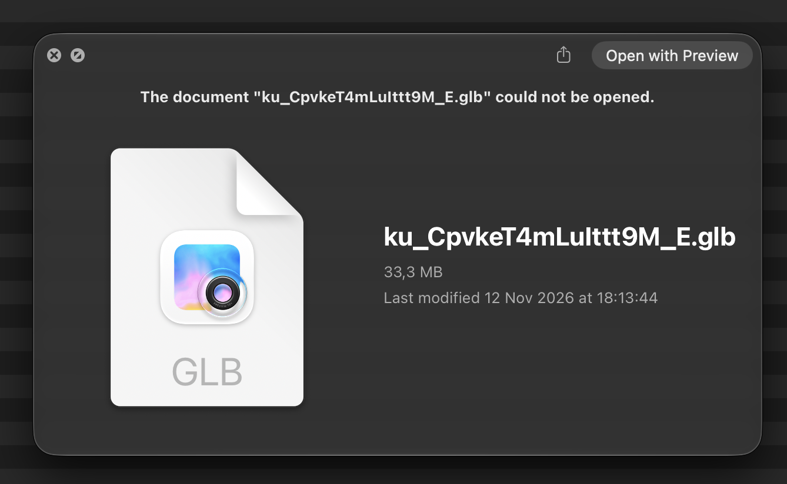
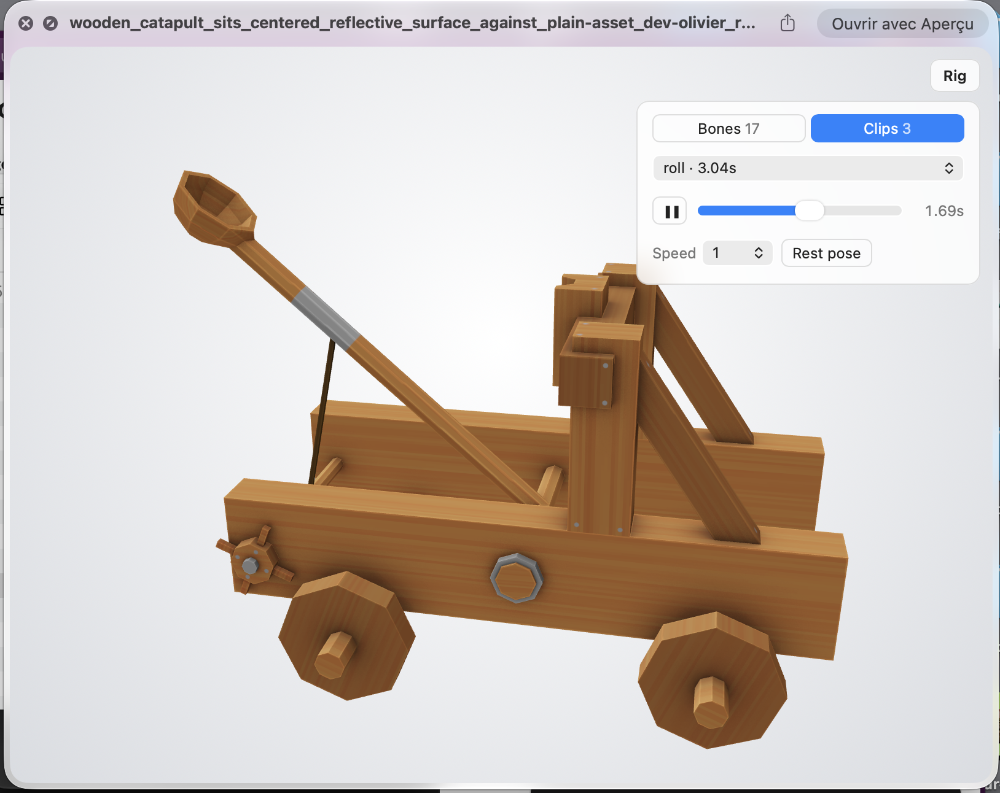

# GLB Quick Look

Quick Look extension to preview `.glb` / `.gltf` / `.fbx` 3D models, Blender `.blend` scenes, MagicaVoxel `.vox` files, `.spz` Gaussian splats and Jupyter `.ipynb` notebooks in the Finder (Space bar) and Spotlight.
Everything is rendered locally (three.js r147 and other libraries bundled in `Extension/js`, no network access).

| Without GLB Quick Look | With GLB Quick Look |
|---|---|
|  |  |
| macOS can't open `.glb` files in Quick Look. | Interactive 3D preview, plus a **Rig** panel to pose bones, drive blendshapes and play baked animation clips. |

## Supported file types

| Extension | Format | Preview |
|---|---|---|
| `.glb`, `.gltf` | glTF 2.0 (binary or embedded JSON) | Interactive 3D, with the **Rig** panel: bone sliders, blendshapes (e.g. ARKit), baked animation clips played in parallel |
| `.fbx` | Autodesk FBX (binary and ASCII) | Interactive 3D, with the **Rig** panel. Textures embedded in the file are shown, external ones are not |
| `.blend` | Blender 2.80 to 5.x (uncompressed, gzip or zstd) | Interactive 3D of the active scene: meshes, transforms, collections, material colors and packed textures. Modifiers, curves, text and external textures are not applied |
| `.vox` | MagicaVoxel | Pixel-art **sprite stacking** (one slice per layer): rotation, tilt, zoom, layer spacing, layer highlight |
| `.spz` | Niantic SPZ v1–v3 Gaussian splats | WebGL 2 splat renderer with **Walk** (inside scenes, e.g. World Labs) and **Orbit** modes |
| `.ipynb` | Jupyter notebook (nbformat 3 and 4) | Rendered notebook: markdown, highlighted code, outputs (text with ANSI colors, images, HTML tables, errors) |

Not supported: Draco/meshopt-compressed glTF. `.usdz` is already previewed by macOS itself.

## How it works

- `Extension/PreviewViewController.swift`: loads the file and injects it into a WKWebView (large `.spz` and `.ipynb` files are served through a `glbql://` URL scheme handler instead of being inlined).
- `Extension/viewer.html`: three.js viewer for `.glb`, `.gltf`, `.fbx` and `.blend` (auto-rotate, orbit, zoom) with a **Rig** panel:
  - **Clips** (default when present): every baked clip with its own play/pause and timeline, so clips can play in parallel; speed and rest pose
  - **Bones**: per-bone X/Y/Z rotation sliders, skeleton overlay
  - **Blendshapes**: morph target sliders
  - FBX goes through the bundled three.js `FBXLoader` (+ fflate); its Phong materials are converted to PBR.
- `Extension/js/BlendLoader.js`: `.blend` reader written for this project. It parses the SDNA struct catalogue stored in every `.blend`, then reads the meshes (legacy `MVert`/`MPoly`, 3.x–4.x generic attributes, 5.x attribute storage), object transforms and parents, the active scene's collections (excluded/hidden ones skipped, collection instances expanded) and materials (Principled/Diffuse base color, packed image textures). zstd via the bundled [fzstd](https://github.com/101arrowz/fzstd) (MIT). Files without meshes show the thumbnail saved by Blender.
- `Extension/vox.html`: `.vox` viewer in **sprite stacking**: the model is cut into one pixel-art slice per Z layer, then the slices are stacked and rotated (2D canvas, no WebGL).
  Drag to rotate (horizontal) and tilt (vertical), scroll to zoom, double-click to refit. The **Stack** panel sets rotation, tilt, zoom, layer spacing (explode the stack), highlights a layer and toggles the drop shadow.
  Only the first model of a multi-model `.vox` is shown.
- `Extension/splat.html`: `.spz` **Gaussian splat** viewer, a small self-contained WebGL 2 renderer (projected 2D Gaussians, depth sort in a Web Worker, front-to-back compositing).
  Scenes seen from inside open in **Walk** mode at the capture viewpoint; objects open in **Orbit** mode. Y-down scenes are flipped automatically.
  Walk: drag to look around, scroll or WASD/QE to move. Orbit: drag to orbit, scroll to zoom. Right-drag or Shift-drag pans, double-click resets. The **Splat** panel switches mode, flips, and sets field of view and splat scale.
  Only the base color is rendered (higher-order spherical harmonics are ignored).
- `Extension/notebook.html`: `.ipynb` viewer: markdown cells (via the bundled [marked](https://github.com/markedjs/marked), MIT), code cells with syntax highlighting and `In [n]` prompts, and outputs: streams (ANSI colors, progress bars collapsed to their final state), images, HTML (pandas tables, in a sandboxed iframe), errors with colored tracebacks. Toggle code / outputs from the top bar.
  A Content Security Policy blocks every script coming from the notebook, and HTML is sanitized. Not rendered: LaTeX math (shown as source), interactive widgets, remote images.
- `App/`: minimal host app (required to embed the extension). It also declares the types macOS doesn't know: `com.ephtracy.magicavoxel.vox`, `com.nianticlabs.spz`, `org.jupyter.ipynb`, and `org.blenderfoundation.blender.file` for Macs without Blender.

## Install

    curl -fsSL https://raw.githubusercontent.com/scenario-labs/QuickLook3dViewer/main/install.sh | sh

Downloads the latest release into `~/Applications` and registers the extension. Then select a supported file in the Finder and press Space.
Universal binary (Apple Silicon + Intel), macOS 13+.

The app is ad-hoc signed, not notarized. If you download the zip from the Releases page with a browser instead, macOS will block it:
unzip it, move it to `~/Applications`, then run `xattr -dr com.apple.quarantine ~/Applications/GLBQuickLook.app` and open it once.

## Troubleshooting

- **A file type still shows the generic preview after installing.** The Finder caches each file's type: run `killall Finder` once (and `qlmanage -r`).
- **Diagnostics.** The extension logs each preview (file, page load, JavaScript errors) to
  `~/Library/Containers/local.olivier.GLBQuickLook.GLBPreview/Data/Library/Caches/preview.log`. The web view is inspectable from Safari's Develop menu.

## Build from source

Requires the Xcode Command Line Tools (`xcode-select --install`).

    ./build.sh             # build (universal), package to dist/, install via install.sh
    ./build.sh --package   # only produce dist/GLBQuickLook.zip

## Release

Push a tag: `git tag v1.5.0 && git push origin v1.5.0`. The GitHub Action builds the zip and attaches it to the release.

`project.yml` (xcodegen) can also generate an Xcode project.
